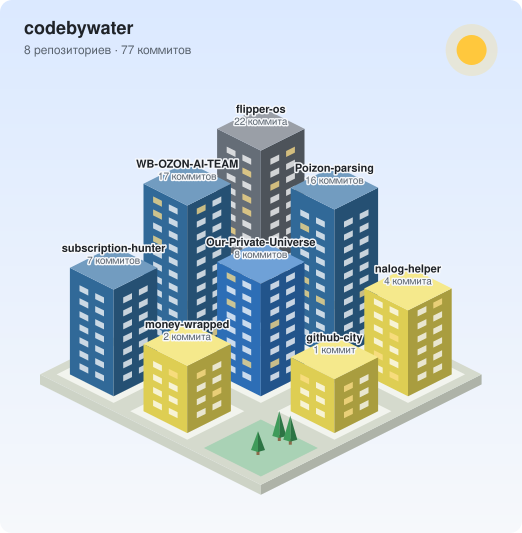

# 🌊 Coder by Water

**Делаю open-source инструменты, которые экономят деньги и время.**\
Личные финансы и налоги, маркетплейсы, ИИ-агенты для Claude Code, железо.

---

## 🏙 Мой город репозиториев

<picture>
  <source media="(prefers-color-scheme: dark)" srcset="assets/city-dark.svg">
  
</picture>

Каждый дом — репозиторий, высота — число коммитов. Город перестраивается каждый день с помощью [GitHub City](https://github.com/codebywater/github-city).

## 👋 Обо мне

- 🛠 Пишу инструменты, которыми пользуюсь сам: от калькулятора налогов до прошивки для Flipper Zero.
- 🔒 Люблю, когда данные пользователя **не уходят в интернет**. Многие мои веб-версии работают целиком в браузере, и это закреплено политикой безопасности страницы.
- 🤖 Собираю ИИ-агентов и скиллы для **Claude Code**, Codex и Cursor, которые решают реальные бизнес-задачи на русском.
- ✅ В каждом проекте есть тесты и CI, документация на русском и описание на английском.
- 🌱 Сейчас развиваю **nalog-helper**: следующим будет патент и учёт праздничных дней в сроках уплаты.

## 🚀 Проекты

### 💸 Деньги и налоги

**[nalog-helper](https://github.com/codebywater/nalog-helper)** · [▶ Посчитать онлайн](https://codebywater.github.io/nalog-helper/)\
Сколько налогов платить ИП на УСН 6% и 15% и самозанятому, по выписке из банка. Находит доходы и расходы, считает налог и взносы (в том числе для ИП с работниками), сравнивает режимы, предупреждает о лимитах и выгружает календарь платежей в .ics. Есть Claude-скилл.\
`JavaScript` · `без зависимостей` · `Claude Code plugin` · `данные не покидают браузер`

**[subscription-hunter](https://github.com/codebywater/subscription-hunter)** · [▶ Проверить выписку](https://codebywater.github.io/subscription-hunter/)\
Находит забытые подписки и автосписания в банковской выписке, считает, сколько уходит в месяц и в год, и подсказывает, как отменить. Есть веб-версия, CLI и Claude-скилл.\
`Python` · `JavaScript` · `Claude Code plugin`

**[money-wrapped](https://github.com/codebywater/money-wrapped)** · [▶ Посмотреть свой год](https://codebywater.github.io/money-wrapped/)\
«Мой год в деньгах»: итоги года по банковской выписке в стиле Spotify Wrapped. Сторис о вашем годе: на что ушли деньги, любимое место, самый дорогой день, доставка в шавермах и ваш финансовый тип, плюс картинка для соцсетей.\
`JavaScript` · `Canvas` · `данные не покидают браузер`

### 🛒 Маркетплейсы

**[WB-OZON-AI-TEAM](https://github.com/codebywater/WB-OZON-AI-TEAM)**\
ИИ-команда для селлеров Wildberries и Ozon: 15 скиллов, которые считают юнит-экономику, следят за ценами конкурентов, делают карточки и ТЗ на инфографику, отвечают на отзывы и вопросы покупателей.\
`Claude Code` · `Codex` · `Cursor` · `Python`

**[Poizon-parsing](https://github.com/codebywater/Poizon-parsing)**\
Собирает из приложения Dewu (Poizon) цены по каждому размеру, артикулы, варианты доставки и таблицы размеров через автоматизацию интерфейса на настоящем телефоне (логика покрыта тестами, на живом телефоне пока не проверялась). Экспорт в CSV и Excel.\
`Python` · `uiautomator2` · `Appium`

### 💌 Веб-приложения

**[Our-Private-Universe](https://github.com/codebywater/Our-Private-Universe)** · [▶ Демо](https://codebywater.github.io/Our-Private-Universe/)\
Приватный архив воспоминаний для двоих: фото, таймлайн и письма, которые открываются в назначенную дату. Замок по времени работает на уровне базы данных (Postgres RLS), а не только в интерфейсе.\
`Next.js` · `TypeScript` · `Supabase` · `Tailwind`

### 🛠 Для разработчиков

**[vypiska](https://github.com/codebywater/vypiska)** · [▶ Проверить свою выписку](https://codebywater.github.io/vypiska/)\
Библиотека разбора CSV-выписок российских банков (Сбер, Т-Банк, Альфа, ВТБ, выписки 1С) в единый список операций: суммы в рублях счёта, отклонённые операции, кодировки, ничего не теряется молча. На ней работают nalog-helper, money-wrapped и subscription-hunter; есть версия для Python.\
`JavaScript` · `Python` · `без зависимостей`

**[github-city](https://github.com/codebywater/github-city)**\
Изометрический город из репозиториев для README профиля: высота дома — число коммитов, цвет — язык, днём солнце, ночью горят окна. Подключается как GitHub Action; город выше на этой странице нарисован им.\
`JavaScript` · `GitHub Action` · `SVG` · `без зависимостей`

### 🐬 Железо

**[flipper-os](https://github.com/codebywater/flipper-os)**\
Кастомная прошивка Flipper Zero на базе Unleashed: собственное меню Flipper OS Toolkit, анимация на рабочем столе и Patrol, журнал обходов с защитой записей через HMAC. Сборка и релизы через GitHub Actions.\
`C` · `Flipper Zero` · `GitHub Actions`

## 🧰 Стек

## 🤝 Как помочь

- ⭐ Поставьте звезду проекту, который пригодился: так его проще найти другим.
- 🐛 Нашли ошибку или неверную цифру в расчётах? Откройте issue в нужном репозитории.
- 🔧 Pull request'ы приветствуются. В каждом проекте есть инструкция, как запустить тесты.

*Turning ideas into code, one line at a time.* 🌊

